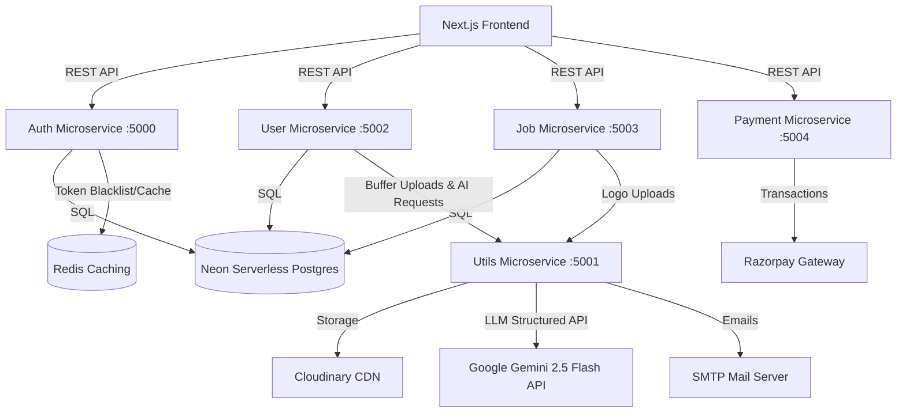
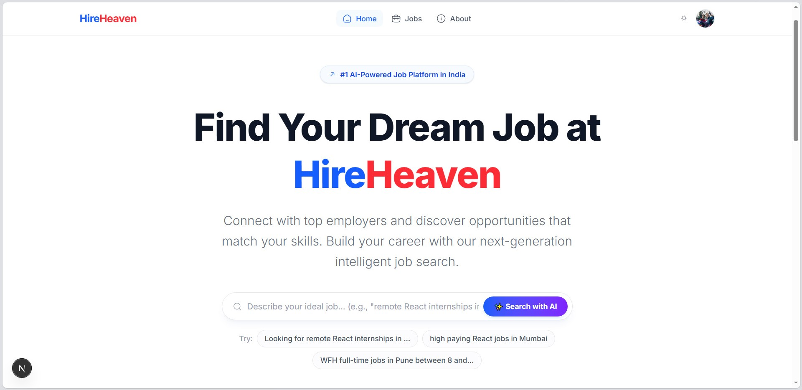
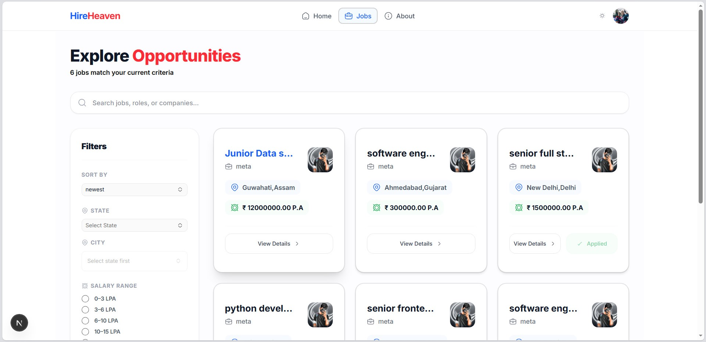
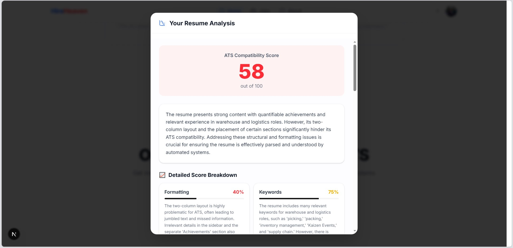
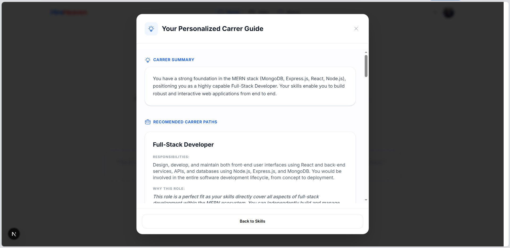
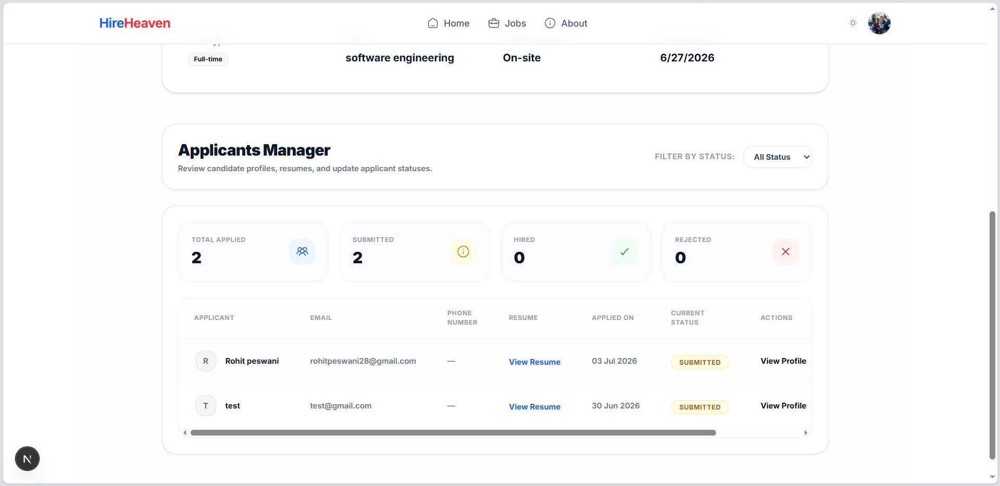
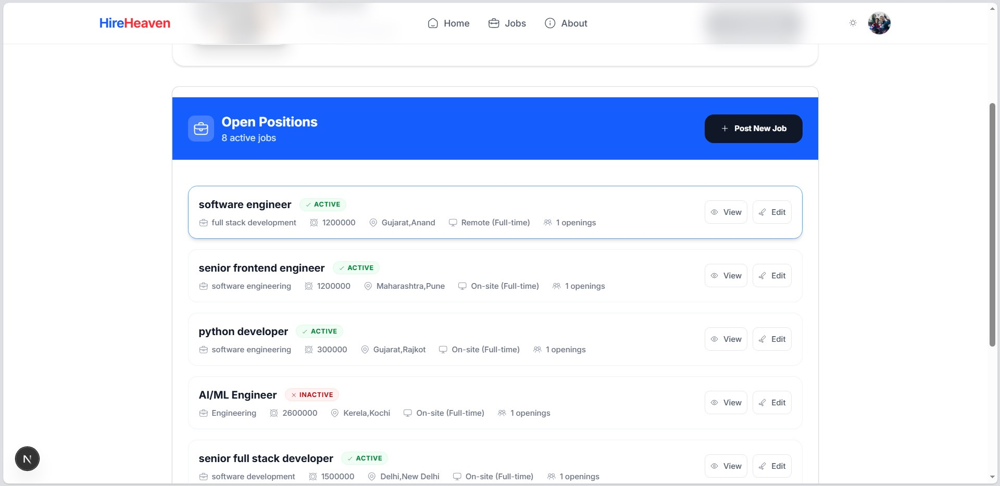

# HireHeaven — AI-Powered Microservices Job Portal

[](https://nextjs.org/)
[](https://react.dev/)
[](https://nodejs.org/)
[](https://expressjs.com/)
[](https://www.postgresql.org/)
[](https://redis.io/)
[](https://tailwindcss.com/)
[](https://deepmind.google/technologies/gemini/)

HireHeaven is a modern, high-performance, microservices-driven AI-powered job board designed to streamline recruitment. Built on a scalable multi-service backend and an interactive frontend, HireHeaven optimizes onboarding, profile matching, job listings, and premium subscription billing.

Unlike monolithic solutions, HireHeaven runs critical domains as isolated microservices. By splitting authorization, candidate profile management, job matchings, payment handling, and AI utility tasks, the platform achieves high reliability, low-latency performance, and modular extensibility.

The platform's standout feature is its native AI integration. Leveraging Gemini 2.5 Flash and Langchain, HireHeaven translates unstructured natural language searches into structured database filters, parses PDF resumes to deliver immediate feedback, and suggests tailored career roadmap recommendations based on a user's skills.

---

## 📋 Table of Contents

- [Project Overview](#-project-overview)
- [Key Features](#-key-features)
- [Tech Stack](#-tech-stack)
- [Project Architecture](#-project-architecture)
- [Folder Structure](#-folder-structure)
- [API Overview](#-api-overview)
- [Security Implementation](#-security-implementation)
- [Performance Optimizations](#-performance-optimizations)
- [Environment Variables](#-environment-variables)
- [Installation & Setup](#-installation--setup)
- [Roadmap & Future Enhancements](#-roadmap--future-enhancements)
- [What I Learned](#-what-i-learned)
- [Screenshots](#-screenshots)
- [Deployment](#-deployment)
- [Contributing](#-contributing)
- [License](#-license)
- [Author](#-author)

---

## 🔍 Project Overview

HireHeaven bridges the gap between candidates looking for careers and recruiters sourcing candidates:

* **For Job Seekers:** Candidates build rich profiles with custom bio descriptions, skill tags, and PDF resumes. They can receive instant AI evaluations of their resumes, request career guidance based on their strengths, upgrade to premium subscriptions, and query the job board using simple conversational sentences.
* **For Recruiters:** Employers register company profiles, publish job postings, track applications, and update applicant progress. When candidate statuses change, automated transactional email alerts keep applicants informed immediately.

---

## 🚀 Key Features

### 🔐 Authentication & Onboarding
* **Secure Auth:** JWT-based user register, login, and token verification flows.
* **Smart Onboarding:** Direct profile picture and resume upload during registration using multipart forms.
* **Password Recovery:** Forgot-password workflow generating tokens with email dispatch for secure password resets.

### 👤 Job Seeker Features
* **Profile Management:** Update personal details, bios, and upload updated resumes or profile pictures dynamically to Cloudinary.
* **Skill Tags:** Add or remove technical skill tags to map match-making capabilities.
* **Application Tracker:** Apply to jobs with a single click and review applications, timestamps, and live hiring statuses.

### 💼 Recruiter & Company Features
* **Company Portfolios:** Recruiters can register and manage up to 3 distinct company profiles complete with logos, descriptions, and websites.
* **Job Board Management:** Post, edit, and deactivate job listings (Full-time, Part-time, Contract, Internship) with specific descriptions, salaries, locations, and open headcount numbers.
* **Applicant Tracking:** View and filter candidates who applied to posted jobs and change status values (`Submitted`, `Hired`, `Rejected`).

### 🤖 AI-Powered Features (Gemini 2.5 Flash)
* **Natural Language Job Search:** Parses raw queries (e.g. *"I want a remote React developer job in NY"*) into precise SQL query filters using Langchain and Gemini's structured JSON outputs.
* **Automated Resume Feedback:** Parses uploaded PDF resumes in base64 format directly through Gemini to output SWOT (Strengths, Weaknesses, Opportunities, Threats) assessments and improvement suggestions.
* **Career Path Planner:** Analyzes a candidate's registered skill set list to construct personalized learning paths and target role recommendations.

### 💳 Payments & Subscription
* **Premium Access:** Integrated Razorpay checkout flow enabling users to purchase premium subscriptions.
* **Webhooks & Verification:** Signature verification for payments ensures secure transaction storage and user tier updates.

### 📧 Transactional Notifications
* **Nodemailer SMTP:** Automation of applicant status change email alerts and registration confirmations.

---

## 🛠️ Tech Stack

| Layer | Technologies |
| :--- | :--- |
| **Frontend** | React 19, Next.js 16 (App Router), Redux Toolkit, Redux Persist, Tailwind CSS v4, Radix UI, Base UI, Hugeicons, React Hook Form, Zod |
| **Backend** | Node.js, Express.js (ES Modules, TypeScript, TSX) |
| **Database** | PostgreSQL (Neon Serverless Postgres), DDL Schema Initialization |
| **Caching** | Redis (Upstash Redis client) |
| **State Management** | Redux Toolkit (Client-side state & thunks), Redux Persist (Session storage) |
| **Cloud Services** | Cloudinary CDN (Media uploads & hosting) |
| **AI / LLM** | Gemini 2.5 Flash, Langchain (`@langchain/google-genai`), `text-embedding-004` (Semantic search preparation) |
| **Dev Tools** | TypeScript, PostCSS, Concurrently, Multer |

---

## 🏗️ Project Architecture

HireHeaven utilizes a decoupled microservices pattern:



* **Frontend:** Serves the UI and manages API calls to the individual backend microservices.
* **Microservices (Auth, User, Job, Payment):** Connect to Neon Serverless Postgres to query data.
* **Utils Microservice:** Serves as a shared helper service. Instead of each service talking directly to Gemini, Cloudinary, or SMTP servers, they delegate those operations to the `Utils` microservice.

---

## 📁 Folder Structure

```
.
├── frontend/                     # Next.js App Router Client
│   ├── public/                   # Static media and assets
│   └── src/
│       ├── app/                  # Route entrypoints (auth, about, company, jobs, payment, profile)
│       ├── components/           # UI elements & Register/Upload modals
│       ├── data/                 # Static local datasets and configurations
│       ├── lib/                  # Helper utilities and client validation schemas
│       ├── providers/            # Redux & Client state providers
│       ├── store/                # Redux Toolkit setup (Slices: auth, applications)
│       └── types.ts              # TypeScript declarations
├── services/                     # Backend Microservices
│   ├── auth/                     # Port 5000: User registration, login, and Redis integration
│   ├── user/                     # Port 5002: User profile editing, skills, and application posts
│   ├── job/                      # Port 5003: Job postings, recruiter workflows, and company profiles
│   ├── payment/                  # Port 5004: Razorpay checkout and verification API
│   └── utils/                    # Port 5001: Cloudinary API, Nodemailer SMTP, and Gemini AI endpoints
├── package.json                  # Root configurations and concurrent startup scripts
└── README.md                     # Documentation
```

---

## ⚡ API Overview

### 🔐 Authentication Service (`/api/auth`)
* `POST /register` — Register user with file payloads (profile photo & resume pdf)
* `POST /login` — Authenticate credentials and return JWT token
* `POST /forgot-password` — Send reset OTP token to registered email
* `POST /reset-password` — Verify OTP and update user password

### 👤 User Service (`/api/user`)
* `POST /my-profile` — Fetch active logged-in user profile details (protected)
* `GET /profile/:userId` — Fetch profile data for a specific user ID (protected)
* `PUT /update-profile` — Modify name, phone, and bio details (protected)
* `PUT /update-profile-pic` — Upload dynamic profile picture to Cloudinary (protected)
* `PUT /update-resume` — Upload dynamic resume PDF file to Cloudinary (protected)
* `POST /skills` — Add new skill strings to candidate profile (protected)
* `DELETE /skills` — Remove skill tags from candidate profile (protected)
* `POST /apply/:jobId` — Submit a application matching candidate credentials (protected)
* `GET /applications` — Retrieve all job applications submitted by candidate (protected)

### 💼 Job Service (`/api/job`)
* `POST /company` — Register a company with logo upload (protected, recruiter role)
* `PUT /company/:companyId` — Delete/Deactivate company record (protected, recruiter role)
* `GET /company/all` — List all companies registered by recruiter (protected)
* `GET /company/:companyId` — Fetch detailed company profile (protected)
* `POST /new` — Publish a new job opening (protected, recruiter role)
* `PATCH /:jobId` — Modify job details (protected, recruiter role)
* `GET /all` — Retrieve all active job openings (public)
* `GET /:jobId` — Retrieve specific job description (public)
* `GET /applications/:jobId` — List applicants who applied to job posting (protected, recruiter role)
* `PATCH /application/:applicationId` — Change application status to Submitted, Hired, or Rejected (protected, recruiter role)

### 💳 Payment Service (`/api/payment`)
* `POST /check-out` — Initialize Razorpay subscription order (protected)
* `POST /verify` — Check Razorpay signature validation and toggle subscriber privileges (protected)

### 🛠️ Shared Utilities Service (`/api/utils`)
* `POST /upload` — Upload media buffer payloads to Cloudinary CDN
* `PUT /delete` — Delete media from Cloudinary using public ID
* `POST /send-email` — Compile HTML templates and send email via Nodemailer
* `POST /career-guidance` — Returns structured AI recommendations for input skills
* `POST /analyze-resume` — Decodes base64 PDF resume and returns structured Gemini feedback
* `POST /job-query-extract` — Extracts structured search conditions from user search prompts

---

## 🔒 Security Implementation

HireHeaven secures API interactions and database tables via the following mechanisms:

1. **JWT Verification:** Microservices authenticate client requests by extracting the Bearer token in the `Authorization` header, validating the payload signature, and retrieving corresponding Postgres user details.
2. **Password Hashing:** Passwords are salted and hashed using `bcrypt` (10 rounds) before getting written to Postgres.
3. **Role-Based Access Control (RBAC):** Recruiter operations (creating jobs, creating companies, modifying applicant statuses) are protected via middleware verification checks enforcing `user.role === 'recruiter'`.
4. **Input Sanitization & Schema Validation:** Both frontend and backend leverage `Zod` schemas to strictly validate model variables and query properties.
5. **Secure File Upload Pipelines:** Files are loaded into memory buffers by `Multer` on the gateway layer and streamed securely via memory buffers to Cloudinary APIs, avoiding temporary disk storage leaks.

---

## ⚡ Performance Optimizations

* **Database Indexing:** 
  To speed up job lookups and matching criteria, indexes are automatically created at initialization:
  * Unique indexes for company names.
  * Indices on `company_id`, `posted_by_recruiter_id`, `title`, and `role` inside the `jobs` table.
  * Indices on `job_id`, `applicant_id`, and `status` inside the `applications` table.
* **Connection Pooling:** Built using `@neondatabase/serverless` adapters for low-overhead database requests.
* **Cached States:** Built-in Redis client hooks ready to store transient access data.
* **Stream Uploads:** Uses memory buffer streaming to upload assets directly to Cloudinary, reducing server I/O latency.
* **Profiling Timers:** Controller flows wrap database operations in `console.time` checkpoints to isolate execution bottlenecks during scaling.

---

## 🔑 Environment Variables

To run this project, configure the following `.env` configurations in each workspace folder.

### Frontend (`/frontend/.env`)
```env
NEXT_PUBLIC_AUTH_SERVICE_URL=http://localhost:5000
NEXT_PUBLIC_UTILS_SERVICE_URL=http://localhost:5001
NEXT_PUBLIC_USER_SERVICE_URL=http://localhost:5002
NEXT_PUBLIC_JOB_SERVICE_URL=http://localhost:5003
NEXT_PUBLIC_PAYMENT_SERVICE_URL=http://localhost:5004
NEXT_PUBLIC_RAZORPAY_ID=<!-- Replace with Razorpay Test/Live ID -->
```

### Auth Service (`/services/auth/.env`)
```env
PORT=5000
DB_URL=<!-- Replace with Neon PostgreSQL URL -->
UTILS_SERVICE_URL=http://localhost:5001
JWT_SECRET=<!-- Replace with secure JWT key -->
FRONTEND_URL=http://localhost:3000
REDIS_URL=<!-- Replace with Upstash Redis Connection String -->
```

### Utils Service (`/services/utils/.env`)
```env
PORT=5001
CLOUDINARY_CLOUD_NAME=<!-- Replace with Cloudinary Name -->
CLOUDINARY_API_KEY=<!-- Replace with Cloudinary Key -->
CLOUDINARY_API_SECRET=<!-- Replace with Cloudinary Secret -->
SMTP_HOST=smtp.gmail.com
SMTP_PORT=465
SMTP_USER=<!-- Replace with SMTP Email Address -->
SMTP_PASS=<!-- Replace with SMTP App Password -->
GEMINI_API_KEY=<!-- Replace with Gemini API Key -->
FRONTEND_URL=http://localhost:3000
```

### User Service (`/services/user/.env`)
```env
PORT=5002
DB_URL=<!-- Replace with Neon PostgreSQL URL -->
UTILS_SERVICE_URL=http://localhost:5001
JWT_SECRET=<!-- Replace with secure JWT key -->
FRONTEND_URL=http://localhost:3000
```

### Job Service (`/services/job/.env`)
```env
PORT=5003
DB_URL=<!-- Replace with Neon PostgreSQL URL -->
UTILS_SERVICE_URL=http://localhost:5001
JWT_SECRET=<!-- Replace with secure JWT key -->
FRONTEND_URL=http://localhost:3000
```

### Payment Service (`/services/payment/.env`)
```env
PORT=5004
DB_URL=<!-- Replace with Neon PostgreSQL URL -->
RAZORPAY_ID=<!-- Replace with Razorpay ID -->
RAZORPAY_SECRET_KEY=<!-- Replace with Razorpay Secret Key -->
JWT_SECRET=<!-- Replace with secure JWT key -->
FRONTEND_URL=http://localhost:3000
```

---

## ⚙️ Installation & Setup

### Prerequisites
* **Node.js** (v18 or higher)
* **PostgreSQL** or **Neon Database** instance
* **Redis** server (or Upstash instance)

### 1. Clone the Repository
```bash
git clone https://github.com/<!-- Replace with your GitHub Username -->/job-portal-microservices.git
cd job-portal-microservices
```

### 2. Install Dependencies
This project uses npm workspaces to manage both frontend and microservice dependencies from the root directory:
```bash
npm install
```

### 3. Create Environment Configuration
Create a `.env` file in the `frontend` folder and in each individual microservice folder inside `/services` as shown in the [Environment Variables](#-environment-variables) section.

### 4. Running the Project in Development Mode
You can start all backend services and the frontend concurrently from the root directory:
```bash
npm run dev-concurrently
```
*Alternatively, if your terminal supports windows terminal tabs:*
```bash
npm run dev
```

---

## 📈 Roadmap & Future Enhancements

* [ ] **API Gateway Integration:** Add a central entry gateway (e.g., Kong or Express Gateway) to route all requests, eliminating the need to expose five separate service ports.
* [ ] **Vector Database & Hybrid Search:** Integrate PGVector in the PostgreSQL database to use the `text-embedding-004` service for semantic job recommendations based on candidate profiles.
* [ ] **Message Broker:** Introduce RabbitMQ or Apache Kafka to handle notifications and status logs asynchronously rather than using direct HTTP calls to the utils service.
* [ ] **Containerization & Deployment:** Write Docker Compose configurations to spin up the services, Postgres DB, and Redis cache locally with a single command.

---

## 🧠 What I Learned

* **Designing Microservice Architectures:** Understood the complexities of dividing a product into logical boundaries (Auth, User, Job, Utilities, Payment), keeping services isolated, and establishing secure HTTP communication paths between them.
* **Structuring LLM Outputs:** Gained experience using Langchain and Gemini's structured outputs (`withStructuredOutput`) to reliably parse natural language text into standardized JSON schemas, ensuring safety and validation on the backend.
* **Database DDL Management:** Mastered writing database schemas that self-initialize on boot safely by utilizing PostgreSQL conditional tables, unique indices, and enum type queries.

---

## 📸 Screenshots


| Dashboard | Job Search Results |
| :---: | :---: |
|  |  |

| AI Resume Analysis | Career Roadmap Planner |
| :---: | :---: |
|  |  |

| Recruiter Dashboard | Job Posting Management |
| :---: | :---: |
|  |  |

---

## 🤝 Contributing

Contributions are welcome! Please follow these steps to contribute:
1. Fork the Project.
2. Create your Feature Branch (`git checkout -b feature/AmazingFeature`).
3. Commit your Changes (`git commit -m 'Add some AmazingFeature'`).
4. Push to the Branch (`git push origin feature/AmazingFeature`).
5. Open a Pull Request.

---


## ✍️ Author

* **Name** - [Rohit Peswani]
* **Email** - [rohitpeswani28@gmail.com](mailto:rohitpeswani28@gmail.com)